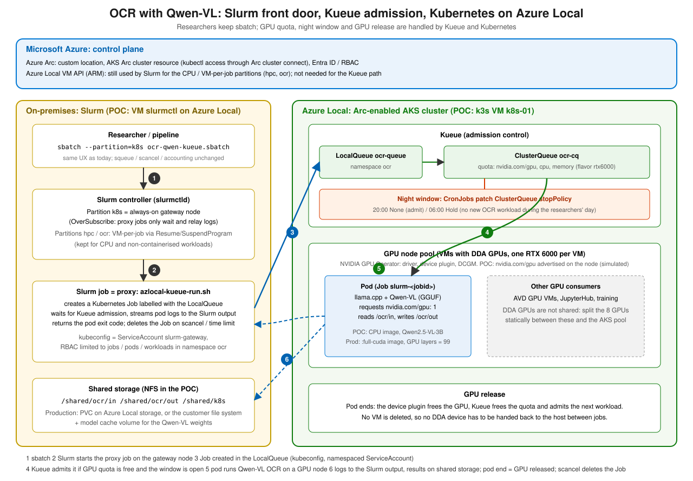

# 09 – Slurm + Kueue + Qwen-VL OCR on Kubernetes (Azure Local)

Researchers keep submitting with Slurm. The GPU work runs as a Kubernetes Job on the Arc-enabled AKS
cluster on Azure Local, and **Kueue** decides when it may start (GPU quota, night window). When the pod
ends, Kubernetes frees the GPU. No VM is deleted, so no DDA device has to be handed back.



## 1. How it works

| # | Step | Component |
|---|------|-----------|
| 1 | `sbatch --partition=k8s ocr-qwen-kueue.sbatch` | Slurm (unchanged UX) |
| 2 | Slurm starts a **proxy job** on the always-on gateway node (`SuspendExcNodes`, partition `k8s`, `OverSubscribe=FORCE:16`) | `slurm/bin/azlocal-kueue-run.sh` |
| 3 | The proxy creates the Job `slurm-<jobid>` with label `kueue.x-k8s.io/queue-name`, using a namespaced ServiceAccount kubeconfig | kubectl |
| 4 | Kueue keeps the Job suspended until the LocalQueue/ClusterQueue has quota (`nvidia.com/gpu`, cpu, memory) and `stopPolicy` is `None` | Kueue |
| 5 | The pod runs `llama-mtmd-cli` with Qwen2.5-VL on each image in `/ocr/in` and writes `/ocr/out/<jobid>` | `k8s/qwen-ocr.sh` |
| 6 | The proxy streams the pod logs to the Slurm output, mirrors the exit code, and deletes the Job on `scancel` or time limit | proxy |

Night window: two CronJobs patch the ClusterQueue (`20:00` → `stopPolicy: None`, `06:00` → `Hold`,
`timeZone: Europe/Paris`). `Hold` stops new admissions and lets running workloads finish. Use
`HoldAndDrain` to evict running ones at 06:00 instead.

Semantics to know: the Slurm job is `RUNNING` while the Kueue workload may still be queued. The proxy prints
the Kueue reason (quota, window). Set `--timeout` (becomes `activeDeadlineSeconds`) and a Slurm `--time`.

## 2. POC status (resource group `rg-hpc-azlocal-slurm`)

| Item | POC | Production |
|------|-----|-----------|
| Kubernetes | k3s on VM `k8s-01` (8 vCPU / 20 GB) on the nested Azure Local | AKS Arc cluster on Azure Local |
| Kueue | v0.20.x, API `kueue.x-k8s.io/v1beta2` (v1beta1 is no longer served) | same, pin the version |
| GPU | `nvidia.com/gpu: 8` advertised on the node (**simulated**) | NVIDIA GPU Operator, DDA RTX PRO 6000 passed to the node VMs |
| Qwen-VL | `ggml-org/Qwen2.5-VL-3B-Instruct-GGUF` with llama.cpp on **CPU** | `:full-cuda` image, `GPU_LAYERS=99`, larger Qwen-VL as needed |
| Storage | NFS `/shared` + hostPath | PVCs (Azure Local CSI or customer file system) |
| Slurm gateway | controller VM `slurmctl` | any always-on Linux host with kubectl and munge |

### Test evidence

| Test | Result |
|------|--------|
| Slurm job → Kueue admission → pod → OCR → exit code | PASS. Admission in about 5 s. French invoice, letter and table recognised (amounts, VAT, dates correct) |
| Output in `/shared/ocr/out/<jobid>` and in the Slurm `--output` file | PASS |
| 3 jobs at once, quota = 2 GPUs | PASS. 2 admitted, the third stayed queued with the Kueue message, then was admitted when a pod ended (GPU quota released) |
| Night window closed (`stopPolicy: Hold`, from the CronJob) | PASS. A new job waits with `ClusterQueue ocr-cq is inactive`, then starts when the window-open CronJob runs |
| `scancel` | PASS. The Kubernetes Job is deleted |
| Timing (CPU, 3 vCPU) | about 2–4 min per document; the first job also downloads the model (about 3 GB) |

### Problems found while testing (and fixes)

- **The Slurm power-down hook deleted the controller VM.** `POWER_DOWN_AFTER_JOB` marks every node of the
  ended job `POWER_DOWN_ASAP`, and that bypasses `SuspendExcNodes`. The epilog and the suspend program now
  only act on nodes with `Feature=azlocal` (VM-backed). Never put a static node in a power-save partition
  without this guard. The controller was redeployed.
- Kueue `v1beta1` is not served any more in v0.20: use `v1beta2` and check with `kubectl get crd`.
- Pods were OOM-killed with 6 Gi: Qwen2.5-VL-3B needs about 8–9 Gi on CPU. Size from a measurement.
- Azure Arc Run Command bodies are size-limited: large payloads (PNG samples) are sent in a separate call.

## 3. Prerequisites for the customer environment

1. **Azure Local cluster** with an Arc-enabled **AKS cluster** (AKS Arc) reachable from the Slurm network
   (kube-apiserver endpoint, port 6443, or Arc cluster connect).
2. **GPU node pool**: RTX PRO 6000 GPUs (the RaaS design lists 4 Dell nodes x 2) assigned by DDA to the AKS worker VMs. Confirm the GPU
   model and driver support in the AKS Arc GPU documentation. Install the **NVIDIA GPU Operator**
   (driver, container toolkit, device plugin). The GPUs given to AKS cannot be used by AVD/JupyterHub at the
   same time: decide the split of the 8 GPUs.
3. **Kubernetes version and Kueue**: Kueue v0.20+ installed, CRDs served as `v1beta2`.
4. **Namespace, queues, quota**: ResourceFlavor (node label of the GPU pool), ClusterQueue with the
   `nvidia.com/gpu` quota, LocalQueue per team/namespace.
5. **Slurm side**: an always-on Linux gateway node in Slurm (a partition dedicated to Kubernetes), with
   `kubectl`, python3 and the proxy script. If Slurm is on-premises outside Azure Local, open the route to the
   Kubernetes API.
6. **Identity**: one ServiceAccount (or Entra identity) per team with RBAC limited to Jobs, Pods, Pod logs and
   Workloads in its namespace. Distribute the kubeconfig on shared storage with 0600 rights.
7. **Container images**: pull from an internal registry or ACR (air-gapped or proxy rules), including
   `llama.cpp:full-cuda` and the Qwen-VL weights (GGUF or Hugging Face format).
8. **Storage**: PVC for input documents/results (ReadWriteMany) and for the model cache.
9. **Network and security**: egress to the registry and model source, or a pre-loaded model volume; no
   patient data in logs; document data classification.
10. **Time zone and window**: confirm the hours (POC: 20:00–06:00 Europe/Paris) and who owns them.

## 4. Steps in the customer environment

1. **Check the cluster**: `kubectl get nodes -o wide`; label the GPU nodes (`gpu.azlocal/model=rtx6000`).
2. **GPU Operator** (AKS Arc VMs have no pre-installed driver path to the host, so let the operator manage it):
   ```bash
   helm repo add nvidia https://helm.ngc.nvidia.com/nvidia && helm repo update
   helm install gpu-operator nvidia/gpu-operator -n gpu-operator --create-namespace
   kubectl get nodes -o json | jq '.items[].status.allocatable["nvidia.com/gpu"]'   # expect 1 per GPU VM
   ```
   Check the device plugin and driver first with `kubectl logs -n gpu-operator -l app=nvidia-device-plugin-daemonset`.
   If the driver is baked into the image, install with `--set driver.enabled=false`.
3. **Kueue**:
   ```bash
   kubectl apply --server-side -f https://github.com/kubernetes-sigs/kueue/releases/download/<version>/manifests.yaml
   kubectl -n kueue-system wait deploy/kueue-controller-manager --for=condition=available --timeout=300s
   ```
4. **Queues**: adapt and apply `k8s/kueue-ocr.yaml` (remove the POC-only hostPath assumptions, set the real
   quota: 1 GPU per node VM, for example `nvidia.com/gpu: 8`, and the cpu/memory of the node pool).
5. **Night window**: apply `k8s/ocr-window.yaml`; check the time zone and run `kubectl create job
   --from=cronjob/ocr-window-close test -n ocr` then `…-open` to test.
6. **Storage**: create the PVCs and set `OCR_PVC` / `MODELS_PVC` in the proxy environment (the POC uses
   hostPath). Pre-load the Qwen-VL weights in the model PVC.
7. **Slurm gateway**: add a node/partition `k8s` (see `slurm/etc/slurm.k8s.conf.tpl`), install
   `azlocal-kueue-run.sh` and `kubectl`, drop `/shared/k8s/<user>.kubeconfig`. If this node is in a
   power-save partition, keep the `Feature=azlocal` guard in the suspend/epilog scripts.
8. **Image and GPU layers**: use `ghcr.io/ggml-org/llama.cpp:full-cuda` (or the customer image) and
   `GPU_LAYERS=99`; set `--gpu 1`, cpu and memory from a real measurement.
9. **Test**:
   ```bash
   sbatch --partition=k8s tests/ocr-qwen-kueue.sbatch
   squeue; kubectl -n ocr get workloads,pods; cat /shared/ocr/out/<jobid>/*.txt
   nvidia-smi   # on the node: the GPU is used, then free after the pod ends
   ```
10. **Operate**: monitor with kube-prometheus / DCGM, set alerts on pending workloads and on window state.

## 5. Operations

| Need | Command |
|------|---------|
| Queue state | `kubectl -n ocr get workloads`; `kubectl get clusterqueue ocr-cq` |
| Why is a job waiting | Slurm output of the job (Kueue message) or `kubectl -n ocr describe workload <name>` |
| Close/open window manually | `kubectl patch clusterqueue ocr-cq --type=merge -p '{"spec":{"stopPolicy":"Hold"}}'` (`None` to open) |
| Cancel | `scancel <jobid>` (the proxy deletes the Kubernetes Job) |
| Release stuck GPU | Pod deleted → device plugin frees the GPU; if the node reports the GPU busy, check the driver and the DDA assignment |

In the POC, all these actions are wrapped by [`demo/demo.sh`](../demo/demo.sh) (bash, runs from Git Bash in VS Code, WSL, Linux or Cloud Shell through Azure Arc Run Command): `health`, `submit [n]`, `jobs`, `watch`, `log N`, `result N`, `describe N`, `cancel N`, `window-close`, `window-open`, `window`. Slurm accounting is not enabled in the POC, so use `squeue -t all`, `scontrol show job N` (about 5 min after the end) or the job log instead of `sacct`.

## 6. Alignment with the RaaS target architecture and with LocalBox AKS

Two references were reviewed after the POC: the LocalBox AKS guide
([Azure/arc_jumpstart_docs](https://github.com/Azure/arc_jumpstart_docs/blob/main/docs/azure_jumpstart_localbox/AKS/_index.md))
and the private working repo `dorianb04/raas-azure-local-docs` (target architecture, "architecture pas à pas").

**Consistent with the POC**

- Kueue with `kueue.x-k8s.io/v1beta2`, one ClusterQueue per team and a LocalQueue per namespace.
- GPU placement by `nvidia.com/gpu` requests; Slurm-style jobs become ordinary Kubernetes Jobs with the label
  `kueue.x-k8s.io/queue-name` and `max-exec-time-seconds` as the equivalent of `--time`.
- Qwen-VL as the OCR vision-language model (the target uses Qwen3-VL served by vLLM; the POC uses Qwen2.5-VL-3B
  with llama.cpp because it runs on CPU).

**Differences to settle with the customer** (the target repo is the reference; the POC is a Slurm-centred variant)

| Topic | RaaS target | This POC |
|-------|-------------|----------|
| Slurm ↔ Kueue | **No bridge**: Slurm keeps the 4×H100 HPC nodes; the platform offers `raas run/status/cancel` (a generated Kubernetes Job) as the "sbatch" of Azure Local | Slurm proxy job creates the Kueue Job, to keep `sbatch` as the only entry point for OCR |
| OCR scheduling | Opportunistic: ClusterQueue `ocr` with nominal quota 0, borrowing in a cohort, PriorityClass `ocr-opportuniste` with `preemptionPolicy: Never`; KEDA scales workers on RabbitMQ; no fixed night window (night = most GPUs idle) | Fixed night window with `stopPolicy` CronJobs; fixed quota |
| Preemption | OCR pods are evicted when a Studio or job reclaims its guaranteed GPU; RabbitMQ replays unacknowledged messages | Nothing preempts: jobs are admitted only if quota is free |
| GPUs | 4 Dell nodes × 2 RTX PRO 6000 = 8 GPU, 3 AKS Arc clusters, Azure Local 2610+ | 8 simulated GPUs on one k3s VM |
| Images and data | Harbor registry, Isilon PVC, UID/GID of the HPC account | hostPath and NFS |

Recommendation: keep the Slurm proxy only if the customer insists that OCR is submitted through Slurm. In that
case combine both designs: put the proxy's Jobs in the opportunistic `ocr` ClusterQueue (nominal quota 0,
`PriorityClass` with `preemptionPolicy: Never`) instead of the fixed window, and make the OCR script restartable
so an eviction only costs the current document. Otherwise follow the target (RabbitMQ + KEDA, no bridge).

**Use the real AKS Arc simulation next.** LocalBox ships a script that creates a real AKS Arc cluster on the
nested Azure Local (`C:\LocalBox\Configure-AksWorkloadCluster.ps1` on `LocalBox-Client`: network
`10.10.0.0/24`, VLAN 110, cluster `localbox-aks`, Entra group for access). Replace the k3s VM with it and reach
it from the gateway with `az connectedk8s proxy -n localbox-aks -g <rg>`. The Kueue manifests and the proxy do
not change; only the kubeconfig and the GPU resource (still simulated, there is no GPU in the nested hosts) do.
Check the nested hosts have enough RAM left first (AKS Arc adds control-plane and worker VMs).

## 7. Production gaps and open questions

- Real GPU run: not tested (no GPU in the POC). Needs `GPU_LAYERS` tuning and memory sizing with the real model.
- Slurm accounting shows the proxy job (one CPU), not the GPU hours. Use Kueue/Prometheus for GPU accounting.
- Slurm and Kueue must not both schedule the same GPUs: one authority per GPU pool (this design: Kueue).
- HA of the gateway (two gateway nodes), kubeconfig rotation, quota per team, priority classes between OCR and
  other GPU work.
- Questions to settle: GPU model and driver support on AKS Arc, how many of the 8 GPUs go to AKS, who owns
  the night window, where the documents are stored, how results are returned.
